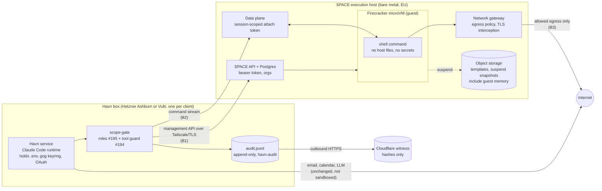

# Perplexity SPACE as Havn's execution boundary: spike result

Card #224. Written 2026-10-22. Research only: nothing was installed, deployed or
bought, and no hosted box was touched. SPACE was cloned and read, not run.

## Answer

**Defer.** SPACE is a serious piece of engineering, and a Firecracker microVM is
the OS-level boundary that the tool guard and the audit log both say they are
not. But it cannot run on any host Havn uses today, and the only documented
install is a development stack.

- **No current Havn host can run it.** SPACE needs Linux x86_64 with `/dev/kvm`.
  Hetzner Cloud states that nested virtualisation is not possible. Vultr Cloud
  Compute does not document it and third-party reports say it is not exposed.
  The Hetzner CAX boxes in our runbook are ARM, which SPACE's only execution
  environment does not cover. Mac and Windows installs are out: Apple Silicon is
  arm64 macOS, and the installer refuses anything but an apt-based Linux host.
- **A viable host is a separate bare-metal box**, about €97 a month plus a €49
  setup fee (Hetzner AX42, excl. VAT), or from €68 a month with no setup fee
  on the Hetzner server auction. Both are in Germany or Finland only. Vultr bare
  metal starts around $120 a month per third-party listings. That is three to
  five times a Havn box, per client, if we keep "one client, one VPS".
- **The documented install is not production.** It is a Kind cluster with Tilt,
  development passwords and signing keys, and it says so ("keep it private and do
  not use production credentials"). The production reference is AWS EKS with RDS,
  S3 and Secrets Manager. Credential injection, the feature that would keep
  secrets out of the guest, resolves references only through AWS Secrets Manager.
- **It is 17 days old.** First public commit 2026-10-05, 562 commits since, no
  tag or GitHub release yet (Cargo says 0.8.0), 150 open issues. Security fixes
  go to "the most recent minor release", of which there is none yet.

**#225 can proceed only as a lab test on a rented, hourly x86 host with nested
virtualisation, after Marc approves the spend. #226 should be narrowed to
suspend and wake. Branching waits**, because forks are refused on the
single-node (direct) substrate and checkpoint, rollback and snapshots are hidden,
incubating APIs.

## Pinned revision and project facts

| Item | Value | Source |
|---|---|---|
| Commit | `60437d062ab918100a7db7aa7c19d0c4ff765a91` (2026-10-23 01:48 UTC, "[db] add cluster-wide runtime environment policy tables (#881)") | [repo](https://github.com/perplexityai/SPACE/tree/60437d062ab918100a7db7aa7c19d0c4ff765a91) |
| License | Apache-2.0, "Copyright 2026 Perplexity AI" | [LICENSE](https://github.com/perplexityai/SPACE/blob/60437d062ab918100a7db7aa7c19d0c4ff765a91/LICENSE) |
| Version | 0.8.0 in `Cargo.toml`. No tags, no releases. The versioning doc says a tag "does not" exist until the release gates pass | [versioning.md](https://github.com/perplexityai/SPACE/blob/60437d062ab918100a7db7aa7c19d0c4ff765a91/docs/versioning.md) |
| Roadmap | 0.9.0 is the last planned breaking release. 1.0 freezes the HTTP API, node-api and guest bridge | versioning.md |
| Maturity | Repo created 2026-10-01, first public commit 2026-10-05, 562 commits in 17 days, ~1.9k stars, 150 open issues | GitHub API, 2026-10-22 |
| Security advisories | None published. That means no history yet, not a clean record | [advisories](https://github.com/perplexityai/SPACE/security/advisories) |
| Security support | "Only the most recent minor release receives security fixes" | [SECURITY.md](https://github.com/perplexityai/SPACE/blob/60437d062ab918100a7db7aa7c19d0c4ff765a91/SECURITY.md) |
| Supported API | 14 HTTP operations: sandbox create/inspect/lifecycle, commands, process control, operations, SSE streams. Snapshots, checkpoint, rollback and file-watch are hidden incubating operations | [api/index.md](https://github.com/perplexityai/SPACE/blob/60437d062ab918100a7db7aa7c19d0c4ff765a91/docs/api/index.md) |
| Lifecycle | running, paused (memory stays resident, not durable), suspended (memory, runtime state and rootfs snapshot), deleted. Idle suspend after 6 hours by default | [architecture.md](https://github.com/perplexityai/SPACE/blob/60437d062ab918100a7db7aa7c19d0c4ff765a91/docs/architecture.md#lifecycle-and-persistence) |
| Execution environment | Only "E0": Linux/x86_64 host, KVM, Firecracker 1.15.1, Linux/x86_64 guest, kernel 6.1.155 | [execution-environments.md](https://github.com/perplexityai/SPACE/blob/60437d062ab918100a7db7aa7c19d0c4ff765a91/docs/execution-environments.md) |
| Operational dependencies | PostgreSQL, Redis-compatible store, S3-compatible object storage (versitygw in Kind), btrfs cache, Docker with privileged containers, Kind, kubectl, Helm, Tilt, Go. Production reference: EKS, RDS, S3, Secrets Manager, ExternalSecrets | [installation.md](https://github.com/perplexityai/SPACE/blob/60437d062ab918100a7db7aa7c19d0c4ff765a91/docs/installation.md), [Kind README](https://github.com/perplexityai/SPACE/blob/60437d062ab918100a7db7aa7c19d0c4ff765a91/infra/space/kind/README.md) |
| E2B compatibility | ECW wrapper, tested against the E2B Python SDK | [ecw.md](https://github.com/perplexityai/SPACE/blob/60437d062ab918100a7db7aa7c19d0c4ff765a91/docs/ecw.md) |

## Host requirements against Havn's deployments

SPACE's installer asks for "an apt-based Linux x86_64 host with KVM", with
`/dev/kvm`, `/dev/net/tun`, loop devices, btrfs, privileged Docker and 30 GiB
free; "a VM must expose the required devices and support nested virtualization"
([installation.md](https://github.com/perplexityai/SPACE/blob/60437d062ab918100a7db7aa7c19d0c4ff765a91/docs/installation.md#prepare-your-environment)).
The Kind node keeps a 40 GiB btrfs cache image and compiles the whole Rust
workspace on first bring-up, so plan on 8 cores and 32 GB or more. That last
figure is our estimate; SPACE does not publish a minimum.

| Havn host | Arch | `/dev/kvm` | Verdict | Source |
|---|---|---|---|---|
| Hetzner Cloud, Ashburn (CPX, shared vCPU) | x86_64 | No. "Can I run virtual machines on cloud servers, or rather is nested virtualization possible? No, this is not possible on cloud server." | Cannot run SPACE | [Hetzner Cloud FAQ](https://docs.hetzner.com/cloud/servers/faq/) |
| Hetzner Cloud CAX (runbook's EU pick) | arm64 | No | Cannot run SPACE, twice over | same, plus E0 is x86_64 only |
| Vultr Cloud Compute vc2 (havn-leif) | x86_64 | Not documented. Third-party reviews report VT-x/AMD-V not exposed on shared-CPU plans | Treat as cannot. Confirming would need a paid instance, out of scope here | [Better Stack review](https://betterstack.com/community/guides/web-servers/vultr-review/) |
| Local Mac install | arm64 macOS | No | Cannot run SPACE. The installer exits on non-Linux | installation.md host check |
| Local Windows install | x86_64 | Only inside WSL2 with nested virtualisation, untested by SPACE, and still needs privileged Docker and btrfs | Not supportable for a client laptop | installation.md |

So **every current Havn host fails the hardware requirement**. SPACE needs a
separate execution host.

## A viable execution host and what it costs

| Option | Price | Notes | Source |
|---|---|---|---|
| Hetzner dedicated AX42-1 | €115.79/month incl. 19% German VAT (about €97.30 excl.), setup €58.31 incl. (about €49 excl.), from 15 June 2026 | Falkenstein or Helsinki. Hetzner has no dedicated servers in the US | [Hetzner price adjustment](https://docs.hetzner.com/de/general/infrastructure-and-availability/price-adjustment/) |
| Hetzner server auction | from €67.70/month excl. VAT, no setup fee | Germany/Finland, older hardware, check the CPU and RAM per listing | [Server auction](https://www.hetzner.com/sb/) |
| Vultr bare metal | from about $120/month | Third-party figure, not confirmed on Vultr's own page (it returned 403). Has Toronto and US regions | [Toolradar](https://toolradar.com/tools/vultr/pricing) |
| Hourly cloud VM with nested virtualisation (lab only) | billed per hour | Google Compute Engine documents nested virtualisation on Intel VMs. Fine for #225, wrong for production because of nested-VM overhead | [GCE nested virtualization](https://cloud.google.com/compute/docs/instances/nested-virtualization/overview) |

For reference, a Hetzner Ashburn CPX21 is now €38.07/month incl. VAT and Vultr
vc2-1c-2gb about $12. A dedicated SPACE host per client multiplies the hosting
bill by roughly 3x to 8x. A shared SPACE host for the whole fleet keeps the cost
down but breaks the "one client, one VPS" isolation the runbook sells
([HOSTED-VPS.md](../HOSTED-VPS.md)).

Hetzner's dedicated servers being EU-only also matters: an Ashburn box would send
every command, and the files it touches, to Germany. That is a residency change
for clients who chose a North American box.

## Fit and gap against the controls Havn already has

SPACE must sit under these, not replace them. Checked on `origin/main` at
`054d2a9` (Release 1.41.0).

| Havn control | What it does today | What SPACE adds | Gap or conflict |
|---|---|---|---|
| Tool guard and evasion monitor, #194 ([tool-guard.ts](../../src/assurance/tool-guard.ts), [evasion.ts](../../src/assurance/evasion.ts)) | Lexical check of every shell and file call, log mode by default. Its own header says "a lexical monitor, not a sandbox" and that computed paths "need OS-level confinement" | Exactly that confinement: a command that slips past the lexical rules runs in a VM with no host filesystem and no `.env` | The guard runs in the Claude Code `PreToolUse` hook ([claude.ts](../../src/runtime/claude.ts)). If Bash moves to a SPACE-backed tool, that tool must still pass through `scope-gate.ts`, and the guard must learn to read its arguments, since today it skips MCP tools |
| Roles and capabilities, #195 ([roles.ts](../../src/assurance/roles.ts), [scope-gate.ts](../../src/assurance/scope-gate.ts)) | Scheduled jobs get only their role's tools and commands, checked outside the model, fail closed | A per-role sandbox template and egress policy (`NetworkPolicyV1`), so a role's network reach is enforced by the gateway, not just by command matching | Email and calendar run through `gog` and `ms-mail.js` on the host with the client's tokens. Those cannot move into the guest without moving the tokens too. Roles stay authoritative; SPACE only narrows the shell |
| Audit log and witness, #196 ([audit-log.ts](../../src/assurance/audit-log.ts), [witness.ts](../../src/assurance/witness.ts), [deploy/audit-witness](../../deploy/audit-witness/README.md)) | Hash-chained, append-only (`chattr +a`) log outside the workspace, shipped to a Cloudflare witness with a 400-day bucket lock | A second, independent record of what ran in the guest, and the guest cannot reach `/var/lib/havn-audit` at all | SPACE does not keep command history ("streams are live, with no replay"). The Havn audit log must stay the record, written on the host before dispatch and after the exit result. SPACE's own logs are operator telemetry, not evidence |
| Obligations, #168/#197 ([obligations.ts](../../src/assurance/obligations.ts)) | Pure logic. **Not wired**: no caller outside `src/assurance/`, and no #197 commit on `origin/main` | A process exit result minted by SPACE is good evidence for an obligation, since the model cannot forge it | Nothing to preserve yet. The brief lists #197 as delivered; on `origin/main` it is not |
| Hosted posture ([HOSTED-VPS.md](../HOSTED-VPS.md)) | All traffic outbound, ufw denies all inbound, one `havn` login, split `havn-admin` | Nothing at the box | A separate SPACE host exposes a management API and a data plane. The box calls them outbound, so the box's posture holds, but the SPACE host becomes a new internet-facing service to harden. Tailscale between box and host would keep it off the public internet |
| Secrets on the box | `.env`, gog keyring, Claude OAuth token live on the box, readable by `havn` | Credential injection at the gateway would let a guest call an API without holding the key | Injection resolves references only via AWS Secrets Manager (`SPACE_CREDMGR_SECRETS_MANAGER_ROLE_ARN`, unset means "credential references are not resolvable", [configuration.md](https://github.com/perplexityai/SPACE/blob/60437d062ab918100a7db7aa7c19d0c4ff765a91/docs/configuration.md#authentication-tls-and-credentials)). Off AWS, guests get no injected credentials. Fine for Havn, since the point is that guests hold none |

The honest summary: SPACE fills the one hole the existing controls name
themselves (no OS-level confinement for the shell), and nothing else. It does
nothing for the bigger exposure, which is that the assistant process itself holds
the client's email and calendar tokens on the box.

## Trust boundaries

What each boundary relies on, and what to check:

| Boundary | Mechanism | Risk to check |
|---|---|---|
| Guest to host | Firecracker hardware VM boundary, jailer | Host services run privileged (node-manager is root, hostNetwork, hostPID). A guest escape lands on a host that serves every client sharing it. Vendor escape testing is Perplexity's evidence, not ours |
| Box to SPACE API (B1) | Bearer token per caller; organisations per tenant | One organisation per client if the host is shared. The token sits in the box's `.env`, so a compromised box can create sandboxes in its own org. Revocation means rotating the token at SPACE and on the box |
| Box to data plane (B2) | Session-scoped attachment token, "not interchangeable" with the management token | Never follow redirects with credentials (SPACE's own rule). Streams have no replay, so the audit log must be written on the host |
| Control plane | Postgres, internal node tokens (`SPACE_INTERNAL_TOKEN`), internal RPC TLS (off only with `SPACE_INTERNAL_RPC_INSECURE_DEV`) | The Kind install uses development passwords and keys. A production-grade non-AWS install is undocumented |
| Guest to internet (B3) | Gateway egress policy, TLS interception with exemptions | Default egress in Kind is "the public IPv4 internet and cluster DNS". Havn would need deny-by-default per role |
| Snapshots and branches | Suspend writes VM memory and rootfs to object storage; forks keep the saved policy | Anything the guest held in memory persists in the snapshot. `SPACE_BYOK_VOLUME_ENCRYPTION` and the platform KEK are off by default. Rule for Havn: no secret ever enters a guest, so snapshots carry none |
| Management exposure | API, admin API, UI, internal API | Must not face the internet. Bind to the tailnet or a private network |

## Deployment options

| Option | Shape | Cost | Isolation | Verdict |
|---|---|---|---|---|
| A. No SPACE | Keep the tool guard, move it to `enforce`, keep secrets unreachable | 0 | Lexical only | Today's baseline |
| B. Shared SPACE host for the fleet | One bare-metal host in the EU, one SPACE org per client, boxes call it over Tailscale | ~€100/month for the fleet | Strong per command, but one host and one control plane across clients | Cheapest viable SPACE shape. Breaks the per-client story and moves data to the EU |
| C. SPACE host per client | A bare-metal box next to each client's VPS, or replacing it | ~€70 to €120/month per client on top of the box | Matches "one client, one VPS" | Cost out of line with a small-business product |
| D. Hourly lab host | GCE nested-virt VM or a month of auction metal, torn down after | Hours of billing, or one month | Lab only | The right vehicle for #225 and #226 |
| E. Lighter sandbox on the box | gVisor, bubblewrap, a separate Unix user, or systemd `ProtectSystem`/`ReadWritePaths` around tool execution | 0 extra hosting | Weaker than a VM, works on shared vCPU | Out of this spike's scope, but probably the better next step for Havn. Worth its own card |

## Effort, cost and ownership

- **Integration**: about 1 to 2 weeks. Replace the built-in Bash tool with a
  SPACE-backed tool, keep `scope-gate` in front of it, teach the tool guard to
  read its arguments, write audit events before dispatch and after the exit
  result, sync files in and out of the guest, and handle the asynchronous
  operation model (poll every lifecycle call, idempotency keys, streams without
  replay).
- **Infrastructure**: option B is about €100/month plus setup. Option C is
  €70 to €120 per client per month.
- **Patching**: Marc owns a Kubernetes stack, Postgres, Redis, object storage,
  Firecracker, the guest kernel and SPACE itself, on a project shipping 30-plus
  commits a day before 1.0. Security fixes land only on the newest minor, so we
  would have to track releases closely, and 0.9.0 is a planned breaking change.
- **Backup**: Postgres and object storage need backups, and suspended snapshots
  hold guest memory. With no secrets in guests that is low value, low risk.
- **Deletion**: client offboarding becomes "delete the org, its sandboxes and
  their snapshots in object storage" on top of destroying the VPS. Needs a tested
  runbook.
- **Ownership**: Marc, alone. That is the real cost.

## Recommendation

**Defer adoption. Run a lab pilot only if Marc wants evidence for a later
decision.**

Blockers to adoption:

1. No Havn host has KVM; a separate bare-metal host is required.
2. Hetzner bare metal is EU-only; Vultr bare metal is the North American option,
   at roughly $120/month.
3. No documented production install off AWS. Only the Kind dev stack.
4. Pre-1.0, no releases, no security history, a planned breaking 0.9.0.
5. Forks are unsupported on the direct (single-node) substrate, and checkpoint,
   rollback and snapshots are hidden incubating APIs.
6. #197 (obligations wiring) is not on `origin/main`, so the control the brief
   expects to preserve does not exist yet.

Revisit when SPACE tags 1.0 or documents a non-AWS production install, or when a
client needs verified execution isolation and will pay for the host.

## Setup plan for the follow-up spikes

Both need paid infrastructure, which this card forbids, so **neither starts
without Marc approving the host and its cost.**

### #225: Havn's containment suite through a SPACE adapter

- **Host**: one GCE Intel VM with nested virtualisation enabled (8 vCPU, 32 GB,
  100 GB disk, Ubuntu 24.04 x86_64), or one Hetzner auction server if Marc
  prefers a fixed month. Torn down at the end. Never a client box.
- **Pin**: SPACE `60437d062ab918100a7db7aa7c19d0c4ff765a91`, Firecracker 1.15.1,
  guest kernel 6.1.155, the `seed:latest` template built from that commit.
  Record the template digest the API returns.
- **Install**: SPACE's Kind path exactly as documented (`install-prereqs.sh`,
  `install-fc-vendor.sh`, `up.sh`), with `SPACE_CONSOLE_PASSWORD` set, no AWS
  credentials, the API bound to localhost.
- **Adapter**: a Havn branch where a SPACE-backed exec tool replaces Bash for a
  test run, behind `scope-gate`, with audit events on the host.
- **Suite**: replay the evasion corpus (`runCorpus()` in `evasion.ts`) and the
  role-refusal cases through the adapter twice, guard in `enforce` and guard
  `off`. Evidence: for each case, the guard verdict, the guest exit result, and
  whether the guest could reach the host file or network target. Add an egress
  test per role policy.
- **Pass**: everything the guard catches is still caught; everything it misses is
  contained by the guest; the audit chain verifies and ships to a test witness.

### #226: pause, resume and branching with outcome evidence

- **Same host and pin as #225**, run straight after it.
- **In scope**: pause/wake (memory resident) and suspend/wake (snapshot), on the
  supported API only. Evidence: file and process state before and after, wake
  latency, and the snapshot's contents checked for any planted marker string, to
  prove the "no secrets in guests" rule.
- **Out of scope until they leave incubation**: fork, checkpoint, rollback. They
  are hidden unless enabled per organisation, and the direct substrate refuses
  forks. If Marc still wants branching evidence, it needs the Kubernetes
  substrate and an explicit opt-in on hidden APIs, and the result says nothing
  about the supported contract.

## Sources

- SPACE at the pinned commit: [README](https://github.com/perplexityai/SPACE/blob/60437d062ab918100a7db7aa7c19d0c4ff765a91/README.md), [architecture](https://github.com/perplexityai/SPACE/blob/60437d062ab918100a7db7aa7c19d0c4ff765a91/docs/architecture.md), [installation](https://github.com/perplexityai/SPACE/blob/60437d062ab918100a7db7aa7c19d0c4ff765a91/docs/installation.md), [versioning](https://github.com/perplexityai/SPACE/blob/60437d062ab918100a7db7aa7c19d0c4ff765a91/docs/versioning.md), [configuration](https://github.com/perplexityai/SPACE/blob/60437d062ab918100a7db7aa7c19d0c4ff765a91/docs/configuration.md), [execution environments](https://github.com/perplexityai/SPACE/blob/60437d062ab918100a7db7aa7c19d0c4ff765a91/docs/execution-environments.md), [direct substrate](https://github.com/perplexityai/SPACE/blob/60437d062ab918100a7db7aa7c19d0c4ff765a91/crates/libs/api/src/controllers/substrate/direct.rs), [SECURITY.md](https://github.com/perplexityai/SPACE/blob/60437d062ab918100a7db7aa7c19d0c4ff765a91/SECURITY.md); hosted guide at [space.docs.perplexity.ai](https://space.docs.perplexity.ai/guide/architecture.html)
- [Hetzner Cloud FAQ](https://docs.hetzner.com/cloud/servers/faq/) (nested virtualisation)
- [Hetzner price adjustment, June 2026](https://docs.hetzner.com/de/general/infrastructure-and-availability/price-adjustment/)
- [Hetzner server auction](https://www.hetzner.com/sb/)
- [Better Stack Vultr review](https://betterstack.com/community/guides/web-servers/vultr-review/), [Toolradar Vultr pricing](https://toolradar.com/tools/vultr/pricing) (third-party)
- [GCE nested virtualization](https://cloud.google.com/compute/docs/instances/nested-virtualization/overview)
